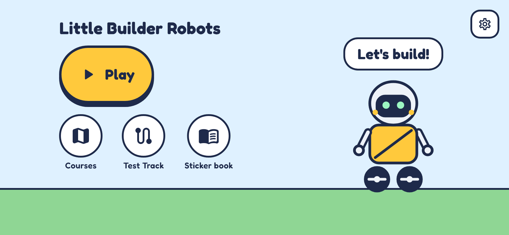
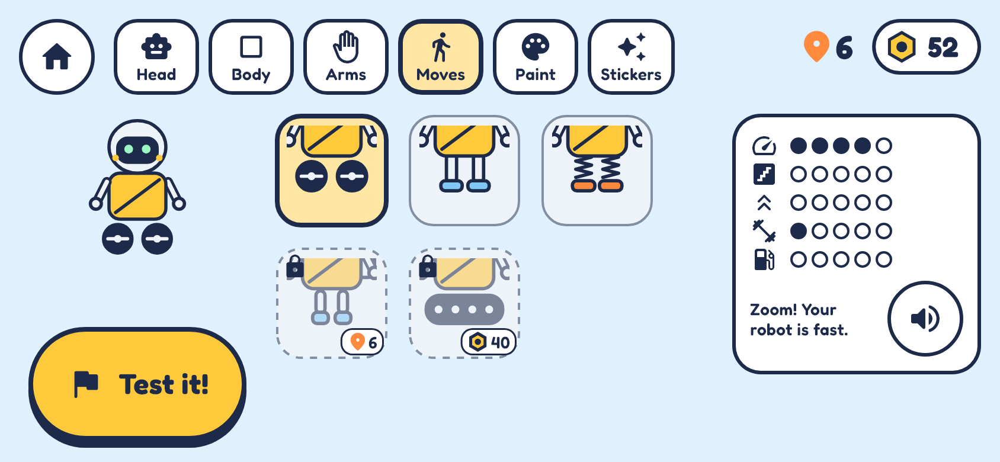
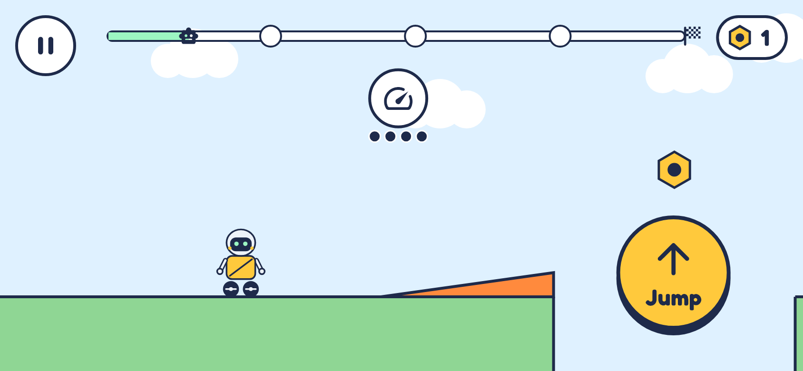

# Little Builder Robots

An offline robot-building game for children aged 3 to 7, built with Flutter
and Flame for iOS (landscape). The child builds a robot from parts, then
tests it on obstacle courses where each obstacle is beaten by a stat or
ability. The full spec is [docs/SRS.md](docs/SRS.md); requirement IDs
(WRK-03, RUN-11, ...) are the source of truth.

**Status:** feature-complete for v1.0 and tested (401 tests, a full scripted
play-through of all 15 courses, and a live run in Chrome with no errors). Not
yet built for iPhone, which needs a Mac. See
[docs/APP_SUMMARY.md](docs/APP_SUMMARY.md) for the full picture.

| Home | Workshop | Run |
|---|---|---|
|  |  |  |

## Documents

- [docs/SRS.md](docs/SRS.md): requirements spec (the source of truth)
- [docs/APP_SUMMARY.md](docs/APP_SUMMARY.md): what is built, how it is tested, what is left
- [docs/AUDIO_CLIPS.md](docs/AUDIO_CLIPS.md): every audio file and its voice line
- [docs/screenshots/](docs/screenshots/): every screen as rendered by the app

## Run it

```sh
flutter pub get
dart run build_runner build --delete-conflicting-outputs
flutter gen-l10n
flutter analyze        # must be clean
flutter test           # includes the course solver test
flutter run -d <ios-simulator>
```

Checks beyond the unit tests:

```sh
flutter test tool/soak/play_session_test.dart        # plays all 15 courses through the UI
flutter test tool/screenshots/screenshots_test.dart  # renders every screen to build/screenshots
flutter build web --profile                          # then serve build/web and run:
node tool/web_check/drive.mjs http://127.0.0.1:8766/ # the real app in headless Chrome
```

The `web/` folder exists only for these browser checks; the product is iOS.

Generated code (`*.g.dart`, `*.freezed.dart`, `lib/core/l10n/gen/`) is not
committed; the two generate commands recreate it.

## How it fits together

| Layer | Where | What |
|---|---|---|
| Domain | `lib/domain` | Pure Dart: models, stat/star/unlock/sticker rules, obstacle needs and hint suggestions, the deterministic `RunSimulator` (fixed 1/120 s steps) |
| Data | `lib/data`, `assets/data` | JSON game data (parts, physics, courses, decals, stickers, Test Track) and the versioned Hive save with backup and migrations |
| State | `lib/app/providers.dart` | Riverpod providers; every progress change is saved at once |
| Screens | `lib/features/<name>` | Flutter screens; the run is a Flame game that only draws simulator state |

All tuning lives in `assets/data/*.json`. The solver test
(`test/domain/sim/course_solver_test.dart`) proves every course can be
finished with the parts owned when it unlocks, that each intended build earns
3 stars in 20 to 40 s, and that Helper mode never changes which builds win.

## Still to do before release

- **Art.** The robot, obstacles and sticker badges are drawn in code. The
  app icon is rendered from the same robot art (`tool/app_icon/`).
- **Voice-over.** All 93 clips exist (`docs/AUDIO_CLIPS.md`): synthesised
  music and effects, plus placeholder text-to-speech voice lines in a US
  voice. Record an en_GB voice before release.
- **Mac-only steps.** Run on the iOS simulator and devices and check 60 fps
  (NFR-01, RUN-10). The NFR-20 native code (edge gestures, home indicator)
  is in `ios/Runner/SceneDelegate.swift` but has not been compiled yet.
  Then TestFlight (SRS 8.1).
- **Placeholders to replace.** Bundle ID `com.example.little_builder_robots`,
  and the privacy policy URL and support email in `lib/app/links.dart`.
- **Playtests.** The SRS 8.1 checklist needs sessions with children.
- **Privacy audit (PRV-10).** `audioplayers` brings in the `http` package for
  streaming URLs; the app only plays bundled assets and makes no requests.
